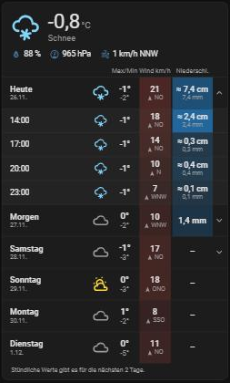

# Vorhersage-Karte

Wettervorhersage als Tagesliste: ein Tag pro Zeile mit Symbol, Höchst- und Tiefstwert, Wind und Niederschlag
(bei Schnee als geschätzter Neuschnee in cm). Jeder Tag lässt sich aufklappen und zeigt darunter die stündlichen Werte.
Gut lesbar am Handy.



## Installation

### Über den Marketplace (Home Assistant 2026.11 und neuer)

1. **Einstellungen** → **Marketplace** → **Aus Link hinzufügen**.
2. Die Adresse dieses Repositorys eintragen, Kategorie **Dashboard**.
3. **Vorhersage-Karte** installieren. Die Ressource wird dabei automatisch eingetragen.

### Über HACS (ältere Versionen)

**HACS** → ⋮ → **Benutzerdefinierte Repositories** → Adresse dieses Repositorys, Typ **Dashboard** → installieren.

### Manuell

`vorhersage-karte.js` nach `/config/www/` kopieren und unter **Einstellungen** → **Dashboards** → ⋮ → **Ressourcen**
als JavaScript-Modul `/local/vorhersage-karte.js` eintragen.

## Verwendung

```yaml
type: custom:vorhersage-karte
entity: weather.forecast_home
```

Mehrere Orte untereinander:

```yaml
type: custom:vorhersage-karte
entities:
  - entity: weather.forecast_home
    name: Zuhause
  - entity: weather.ferienhaus
    name: Ferienhaus
```

## Konfiguration

| Option | Standard | Beschreibung |
|---|---|---|
| `entity` / `entities` | – | Wetter-Entität(en), bei mehreren optional mit `name` |
| `titel` | – | Überschrift in der Karte |
| `tage` | `7` | Anzahl Tage |
| `heute_offen` | `true` | heutigen Tag aufgeklappt zeigen |
| `stunden_schritt` | `1` | Stundenwerte: `1` jede Stunde, `3` alle 3 Stunden |
| `schnee` | `true` | bei Schnee den Niederschlag als Neuschnee in cm schätzen (1 mm ≈ 1 cm) |
| `kopf` | `false` | aktuelles Wetter oben anzeigen (erster Ort) |
| `temperatur`, `luftfeuchte`, `luftdruck`, `wind_geschwindigkeit`, `wind_richtung` | – | Sensoren der eigenen Wetterstation für den Kopf |

Aufklappen lassen sich nur Tage, für die der Wetterdienst Stundenwerte liefert
(beim Standard-Dienst met.no die nächsten 48 Stunden). Böen und Niederschlagswahrscheinlichkeit
werden angezeigt, wenn der Wetterdienst sie liefert.

## Lizenz

MIT
